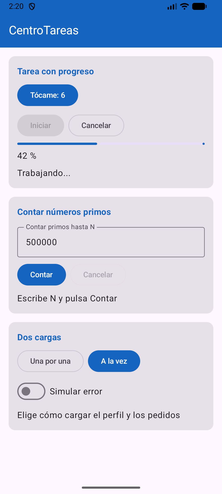
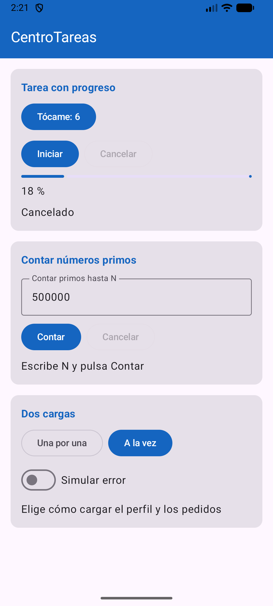
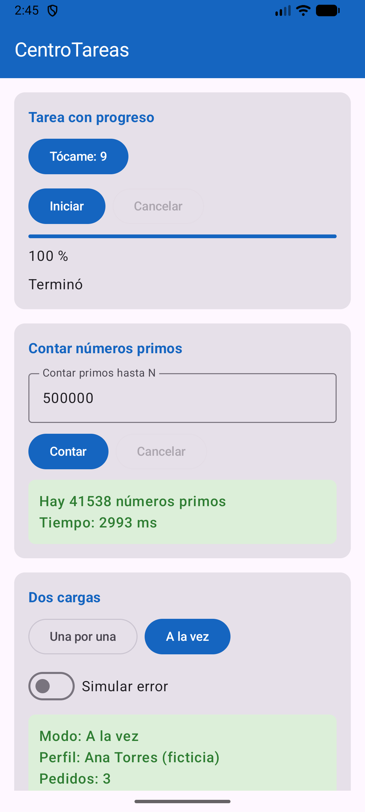
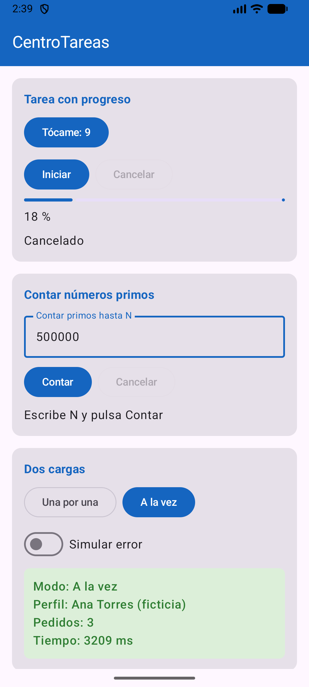
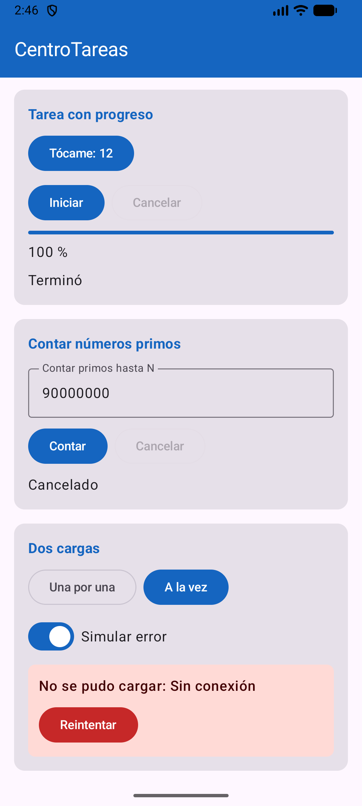

# CentroTareas

**Autor:** Luis Cucho · Programación en Móviles · Semana 14 · Hilos en Android

App en **Kotlin + Jetpack Compose + Material 3** (sin XML) que hace tres trabajos que tardan sin congelar nunca la pantalla:

1. **Tarea con progreso:** barra de 0 a 100 % en unos 4 s, que se puede cancelar.
2. **Contar números primos:** cálculo pesado en `Dispatchers.Default` que se puede cancelar a mitad.
3. **Dos cargas:** perfil (2 s) y pedidos (3 s), una por una (≈ 5 s) o a la vez con `async` (≈ 3 s), con error simulado y reintento.

El botón **Tócame** es la prueba de vida: si sigue sumando, el hilo principal está libre.

Todos los datos son ficticios (Ana Torres, Pedidos 101 a 103). La app no usa internet ni permisos.

## Paquetes

```
com.tecsup.centrotareas/
├── MainActivity.kt                 crea el ViewModel con su Factory
├── model/
│   └── Estados.kt                  PrimosUi, CargaUi (sealed interface)
├── data/
│   ├── TareasRepository.kt         interface
│   └── TareasRepositoryLocal.kt    cargas simuladas y contarPrimos
├── viewmodel/
│   ├── TareasViewModel.kt          corrutinas, Job, StateFlow
│   └── TareasViewModelFactory.kt
└── ui/
    ├── PantallaTareas.kt           las tres tarjetas
    └── theme/                      colores y tema Material 3
```

## Arquitectura MVVM + Repository

```
View (PantallaTareas)
   |  eventos: botones              ^  collectAsStateWithLifecycle()
   v                                |
ViewModel (TareasViewModel)  --- StateFlow --->
   |  viewModelScope.launch { ... }
   v
TareasRepository (interface)  --->  TareasRepositoryLocal
                                    (cargas simuladas y contar primos)
```

| Capa | Conoce a | No hace |
|---|---|---|
| View | Solo a su ViewModel | No lanza corrutinas ni usa `Thread`. Muestra el estado y avisa los eventos |
| ViewModel | Solo a la interface del Repository | No conoce Composables, no recibe `Context` y no bloquea el hilo principal |
| Repository | Nada de la UI | Sus funciones `suspend` cambian de hilo con `withContext` y no bloquean a quien las llama |

## Observación del Paso 1

Al pulsar **Tarea larga (MAL)** la pantalla se congela unos 4 segundos: el botón **Tócame** no suma, el botón no muestra la animación de pulsado y nada responde. Pasado ese tiempo aparece directamente **Terminó**.

**¿Por qué no se ve "Trabajando..."?** `Thread.sleep(4000)` corre en el hilo principal, que es el mismo que dibuja la pantalla. El mensaje cambia a "Trabajando...", pero el hilo queda dormido antes de poder dibujar el siguiente fotograma. Cuando despierta, el mensaje ya vale "Terminó", y eso es lo único que llega a dibujarse.

**¿Y si la espera fuera de 10 segundos?** Android mostraría el diálogo **ANR** («La aplicación no responde») con las opciones de esperar o cerrar la app. Un toque que no se atiende en unos 5 segundos dispara ese diálogo.

## Capturas

| Tarea con progreso | Cancelada |
|---|---|
|  |  |

| Primos | Una por una frente a A la vez |
|---|---|
|  |   |

| Error y Reintentar |
|---|
|  |

## Pruebas de aceptación

| Prueba | Resultado esperado | OK |
|---|---|---|
| Tarea larga: tocar Tócame mientras trabaja | El contador sigue sumando | ✅ |
| Logcat con filtro `HILO` | `main` antes y después; `DefaultDispatcher-worker` dentro | ✅ |
| Iniciar la tarea con progreso | La barra avanza de 0 a 100 % en ≈ 4 s | ✅ |
| Cancelar a mitad | La barra se detiene, dice Cancelado y se puede iniciar otra vez | ✅ |
| Pulsar Iniciar dos veces seguidas | No se lanzan dos tareas (el botón está deshabilitado) | ✅ |
| Primos hasta 1000 | Resultado 168 | ✅ |
| Primos con N grande | La pantalla no se congela y Cancelar funciona | ✅ |
| Una por una | ≈ 5 s y resultado correcto | ✅ |
| A la vez | ≈ 3 s y resultado correcto | ✅ |
| Error simulado + Reintentar | Recuadro rojo; al desactivar el interruptor y reintentar, éxito | ✅ |
| Rotar la pantalla durante la tarea | La tarea continúa y el progreso no se reinicia | ✅ |
| Revisar el código | `git grep` no encuentra `GlobalScope`, `runBlocking` ni `Thread.sleep` | ✅ |

Además, `TareasRepositoryLocalTest` comprueba los valores de referencia de los primos: 25, 168, 1229, 9592 y 41 538.

```bash
./gradlew testDebugUnitTest
```

## Para pensar

**1. ¿Por qué no se veía "Trabajando..." en el Paso 1?**
Porque el hilo principal es el único que dibuja. `Thread.sleep` lo dejó dormido justo después de cambiar el mensaje, sin tiempo para dibujar un fotograma. Al despertar, el mensaje ya era "Terminó", y solo se dibujó ese valor final.

**2. ¿Qué diferencia hay entre `Thread.sleep` y `delay`?**
`Thread.sleep` **bloquea el hilo**: nadie más puede usarlo mientras duerme. `delay` **suspende la corrutina**: la corrutina se aparta, el hilo queda libre para otros trabajos (por ejemplo, dibujar) y la corrutina continúa cuando pasa el tiempo. Además, `delay` revisa la cancelación y `Thread.sleep` no.

**3. ¿Por qué `Dispatchers.Default` para los primos y `Dispatchers.IO` para la red?**
Contar primos usa CPU todo el tiempo. `Default` tiene tantos hilos como núcleos, que es lo óptimo para cálculo. La red y el disco pasan casi todo el tiempo esperando, sin usar CPU. `IO` tiene muchos más hilos (64 o más) para que esas esperas no acaparen los pocos hilos de `Default`.

**4. ¿Qué pasaría con la corrutina si el usuario cierra la pantalla? ¿Qué papel cumple `viewModelScope`?**
`viewModelScope` ata las corrutinas al ciclo de vida del ViewModel. Al **rotar**, la Activity se recrea, pero el ViewModel sobrevive y la tarea sigue (por eso el progreso no se reinicia). Al **cerrar** la pantalla de verdad, se llama a `onCleared()` y `viewModelScope` cancela todas sus corrutinas. Así no se desperdicia trabajo ni se escribe en una pantalla que ya no existe. Con `GlobalScope` la corrutina seguiría viva sin dueño: una fuga.

**5. ¿Por qué `async` tarda 3 s y no 5 s? ¿Qué pasa si una de las dos cargas falla?**
Con `async` las dos cargas empiezan al mismo tiempo y esperan en paralelo, así que el total es el de la más lenta: máximo(2 s, 3 s) = 3 s. Una por una, la segunda no empieza hasta que termina la primera: 2 + 3 = 5 s. Si una falla, `coroutineScope` (concurrencia estructurada) **cancela la otra** y relanza la excepción en `await()`. El `try/catch` del ViewModel la convierte en el estado `Error` y la app no se cierra.

## Versiones actualizadas respecto a la guía

La guía es de años anteriores. Se usaron las versiones estables actuales:

| Elemento | Guía | Este proyecto | Motivo |
|---|---|---|---|
| `lifecycle-viewmodel-compose` | 2.8.7 | 2.10.0 | Versión estable actual |
| Recolección del estado | `collectAsState()` | `collectAsStateWithLifecycle()` | Deja de recolectar cuando la app está en segundo plano (recomendación oficial) |
| `LinearProgressIndicator` | `progress = progreso` | `progress = { progreso }` | La firma con `Float` está obsoleta en Material 3 |
| Android Gradle Plugin | — | 9.4.1 (Kotlin integrado) | Ya no hace falta el plugin `kotlin-android` |
| compileSdk / targetSdk | — | 37 | SDK instalado |

## Fase 2 · Mejoras con IA (rama `mejora-ia`)

| Mejora | Qué hace | Capas |
|---|---|---|
| Progreso desde el Repository | `tareaConProgreso(): Flow<Float>` con `flow { emit() }` y `flowOn(Dispatchers.Default)`; el ViewModel solo recolecta | Repository + ViewModel |
| Primos con progreso | `contarPrimos(hasta, alAvanzar)` avisa cada 1 %; `PrimosUi.Calculando(progreso)` muestra barra y % | Repository + ViewModel + View |
| Tiempo máximo | Interruptor «Tiempo máximo 2 s»: `withTimeout(2000)` corta la carga y muestra «Tardó demasiado» | ViewModel + View |
| Comparación de tiempos | Tarjeta con tabla de veces, último y promedio de cada modo, más el ahorro de A la vez | Model + ViewModel + View |

| Primos con progreso | Comparación de tiempos |
|---|---|
|  |  |

El detalle de los prompts, lo que respondió la IA y lo que se revisó está en [PROMPTS.md](PROMPTS.md).

### Pruebas

```bash
./gradlew testDebugUnitTest
```

- `TareasRepositoryLocalTest`: valores de referencia de los primos.
- `TareasViewModelTest`: 9 pruebas con tiempo virtual (`runTest` + `StandardTestDispatcher`). Comprueban que Una por una tarda 5000 ms, A la vez 3000 ms y el timeout corta a los 2000 ms; también cubren cancelar, error + reintentar, la comparación y los primos reales.
